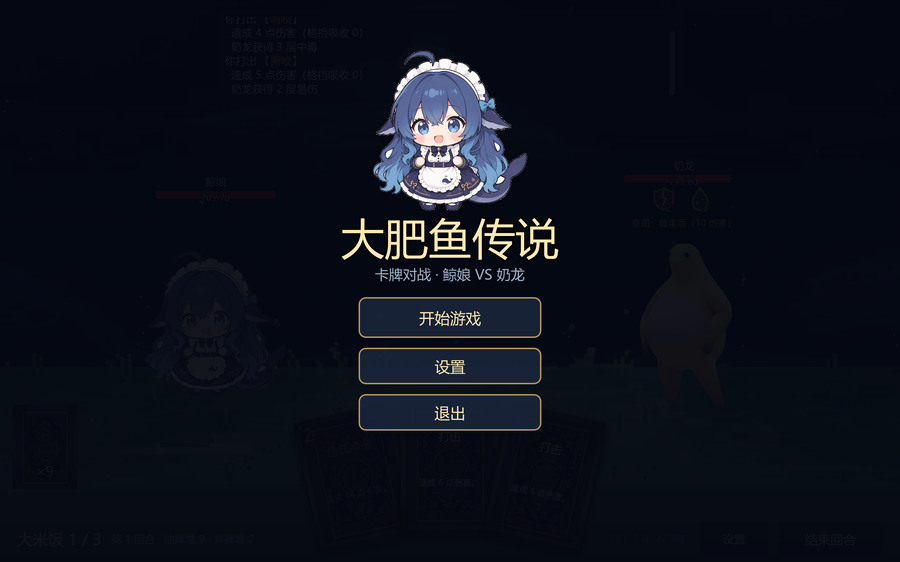

# 大肥鱼传说

一个用 **Godot 4.7.2** 做的卡牌对战小游戏 demo：鲸娘 VS 奶龙，玩法参考《杀戮尖塔》。



## 玩法

- 回合制：每回合 3 点「大米饭」能量、抽 5 张牌，出牌后按「结束回合」，奶龙按**提前预告的意图**行动。
- 状态：易伤（受伤 ×1.5）、虚弱（伤害 ×0.75）、中毒（回合开始掉血，无视格挡）。
- 敌人：奶龙 80 HP，意图循环为 糖浆雨 10 / 奶泡膨胀 格挡+10 / 糖晶暴食 16 / 糖浆连击 6×2。

## 操作

| 操作 | 说明 |
| --- | --- |
| 拖拽卡牌 | 拖到草坪线以上松手打出；直接单击也能打出 |
| 悬停卡牌 | 放大 + 金色描边 + 效果浮窗 |
| 悬停状态图标 | 显示格挡 / 易伤 / 虚弱 / 中毒的说明 |
| 结束回合 | 底部按钮 |
| 设置 | 底部按钮，可调音乐 / 音效音量（保存到 `user://settings.cfg`） |
| F11 / M / Esc | 全屏切换 / 静音 / 退出全屏 |

## 运行

1. 安装 [Godot 4.7.2](https://godotengine.org/download)（标准版即可，不需要 .NET）。
2. 用编辑器打开 `project.godot`，按 F5 运行；或命令行：

```powershell
godot --path .
```

## 上传到 GitHub

仓库远程：`https://github.com/liangyi231/game`（分支 `main`）。

第一次推送需要登录 GitHub 一次（凭据由 Git Credential Manager 保存，之后不再问）：

- **最简单**：双击 `tools/推送到GitHub.bat`，弹窗里用浏览器登录 GitHub，登录完自动推送并打开仓库页。
- 或在项目目录执行：`git push origin main`
- 或用 GitHub Desktop：Add existing repository → Push origin。

> 注意：`dist/` 里的打包产物（约 48 MB 的 exe、网页版 zip）默认**不进仓库**。
> 想把 exe 也放到 GitHub，用仓库的 **Releases** 页面手动上传附件即可（仓库网页 → Releases → Draft a new release），不要把大文件提交进 git 历史。

## 打包分享

见 [`docs/分享给朋友.md`](docs/分享给朋友.md)：

- 电脑：`dist/大肥鱼传说-电脑版.zip`（单文件 exe，双击即玩）
- 手机 / 浏览器：Web 导出 + 静态托管（Netlify Drop / itch.io）或本地 http 服务

重新导出（需要安装 4.7.2 导出模板）：

```powershell
$godot = 'Godot_v4.7.2-stable_win64_console.exe'
& $godot --headless --path . --export-release "Windows Desktop" "dist\windows\大肥鱼传说.exe"
& $godot --headless --path . --export-release "Web" "dist\web\index.html"
```

## 目录结构

```
scenes/battle.tscn          启动场景（根节点挂 scripts/battle/battle_screen.gd）
scripts/battle/             战斗状态机 + 全部 UI（代码构建，无 .tscn 布局）
scripts/cards/card_db.gd    卡牌数据（加牌只改这里）
scripts/audio/              Sfx / Music 两个 autoload
art/                        角色、敌人、卡面、背景、图标（SVG）
audio/                      音效与循环 BGM（均为原创合成，不含第三方素材）
docs/                       设计文档、截图、分享说明
tools/                      素材/音频生成与打包脚本
```

## 设计文档

- [`docs/卡牌战斗设计.md`](docs/卡牌战斗设计.md)：数值、状态、动画参数、后续计划
- [`docs/分享给朋友.md`](docs/分享给朋友.md)：把 demo 发给朋友（电脑 / 手机）
- [`docs/资源库清单.md`](docs/资源库清单.md)：可复用的开源素材

## 素材说明

角色/敌人图来自作者提供的图片并做了抠图处理；卡面、背景为作者提供素材。
所有**音频**（音效 `seekseek` / `laugh` / `hurt`、循环 BGM）都是本项目脚本生成的原创音频，不包含任何第三方歌曲片段。
